# Technical Process

This document explains how I prepared, validated, and analysed the Olist e-commerce dataset using SQL Server.

The workflow moved from raw CSV files to a validated analytical view, then to Power BI dashboards and business findings.

## Workflow

```text
Data collection and import
→ Explore and understand the data
→ Define the information required
→ Join source tables
→ Clean and transform the data
→ Add delivery-performance fields
→ Prepare the final analytical view
→ Run quality and quantity checks
→ Analyse customer retention
→ Build Power BI dashboards
→ Validate results in Excel
```

## 1. Data collection and import

I downloaded the Olist dataset from Kaggle in CSV format and imported the files into SQL Server using SQL Server Management Studio (SSMS).

I reviewed each file to understand its contents and how the tables related to one another.

### Source tables

| Table | What it provides |
|---|---|
| `orders_dataset` | Order status, purchase date, and delivery dates |
| `customers_dataset` | Customer location and unique customer identifier |
| `order_items_dataset` | Items, sellers, price, and freight value |
| `order_payments_dataset` | Payment value |
| `order_reviews_dataset` | Review score and review identifier |
| `products_dataset` | Product category |
| `sellers_dataset` | Seller location |
| `product_category_translation` | English product-category names |


## 2. Explore and understand the data

Before joining the tables, I checked how orders, customers, items, payments, and reviews were connected.

### Key data-grain issue

A single `order_id` can contain multiple items. It can also have multiple payment records and, in some cases, multiple review records.

This means a joined table can contain repeated order, payment, and review values at item level. A direct sum of `payment_value` across the joined table could therefore overstate revenue.

For this reason, revenue and other order-level measures were calculated once per distinct delivered `order_id`.

### Review handling

Some orders had no review score. I retained these records because a missing review does not prove dissatisfaction.

For review analysis, I included only orders with a review score. For sales, delivery, and retention analysis, an order without a review could still be included.

### Initial missing-record check

I ran an initial check for missing or unlinked order and review information.

```sql
SELECT DISTINCT
    OD.customer_id,
    O.order_id,
    R.review_id,
    R.review_score
FROM dbo.order_items_dataset AS O
FULL JOIN dbo.order_reviews_dataset AS R
    ON O.order_id = R.order_id
FULL JOIN dbo.orders_dataset AS OD
    ON O.order_id = OD.order_id
WHERE OD.customer_id IS NULL
   OR O.order_id IS NULL
   OR R.review_id IS NULL;
```


**Result:**  
This query identified records with incomplete order, customer, or review relationships. It does not isolate only orphaned review records: orders without a review are also returned because the review fields are null after the join.

Orders without reviews were retained for sales, delivery, and retention analysis. They were excluded only from review-based metrics.

## 3. Define the information required

I identified the information needed for the three main areas of analysis.

| Analysis area | Information required |
|---|---|
| Sales | Order date, order status, customer state, product category, price, payment value, seller state |
| Delivery | Purchase date, shipping limit, carrier delivery date, estimated delivery date, customer delivery date |
| Customer satisfaction and retention | Review score, customer unique identifier, order identifier, order date, delivery outcome |

### Key analytical decisions

- I used `customer_unique_id` for customer-level repeat-purchase analysis.
- I used `order_id` to prevent orders from being counted more than once.
- I treated delivered orders as completed purchases for revenue and repeat-purchase analysis.
- I focused on calendar dates rather than timestamps.

## 4. Join the source tables

I joined the source tables needed for sales, delivery, and customer-satisfaction analysis.

The source tables have different levels of detail:

- `orders_dataset` has one row per order.
- `order_items_dataset` can have multiple rows per order.
- `order_payments_dataset` can have multiple rows per order.
- `order_reviews_dataset` can have multiple review records per order.

Joining these tables can create repeated order, payment, and review values at item level. `SELECT DISTINCT` removes fully identical rows, but it does not solve every duplication issue caused by different table grains.

For that reason, the joined query was used to prepare the analytical dataset—not to calculate revenue. Revenue was calculated separately at order grain.

### Join design

| Table | Join key | Information added |
|---|---|---|
| `orders_dataset` | `order_id` | Order status and delivery dates |
| `order_reviews_dataset` | `order_id` | Review score and review identifier |
| `order_items_dataset` | `order_id` | Product, seller, price, and freight value |
| `products_dataset` | `product_id` | Product category |
| `order_payments_dataset` | `order_id` | Payment value |
| `customers_dataset` | `customer_id` | Customer location and unique customer identifier |
| `sellers_dataset` | `seller_id` | Seller location |
| `product_category_translation` | `product_category_name` | English category name |

```sql
USE Olist_Ecommerce_data;

SELECT DISTINCT
    OD.order_id,
    C.customer_id,
    C.customer_city,
    C.customer_state,
    CN.product_category,
    OI.price,
    OD.order_purchase_timestamp,
    OI.shipping_limit_date,
    OD.order_delivered_carrier_date,
    OD.order_estimated_delivery_date,
    OI.freight_value,
    OP.payment_value,
    OD.order_delivered_customer_date,
    O.review_score,
    OD.order_status,
    S.seller_id,
    S.seller_city,
    S.seller_state
FROM dbo.orders_dataset AS OD
LEFT JOIN dbo.order_reviews_dataset AS O
    ON OD.order_id = O.order_id
LEFT JOIN dbo.order_items_dataset AS OI
    ON OD.order_id = OI.order_id
LEFT JOIN dbo.products_dataset AS P
    ON OI.product_id = P.product_id
LEFT JOIN dbo.order_payments_dataset AS OP
    ON OI.order_id = OP.order_id
LEFT JOIN dbo.customers_dataset AS C
    ON OD.customer_id = C.customer_id
LEFT JOIN dbo.sellers_dataset AS S
    ON OI.seller_id = S.seller_id
LEFT JOIN dbo.product_category_translation AS CN
    ON P.product_category_name = CN.product_category_name;
```


**Note:**  
Use the actual column names from your imported translation table. If your imported table uses `Portugues`, replace `CN.product_category_name` with `CN.Portugues` and add a note explaining the imported column name.

## 5. Clean and transform the data

I standardised the fields needed for consistent reporting.

### Actions taken

- Removed underscores from product-category names.
- Converted relevant datetime fields to dates.
- Rounded price, freight value, and payment value to two decimal places.
- Prepared date fields for monthly and yearly analysis.

```sql
REPLACE(CN.product_category, '_', ' ') AS product_category,
CAST(OD.order_purchase_timestamp AS DATE) AS order_date,
CAST(OI.shipping_limit_date AS DATE) AS shipping_limit_date,
CAST(OD.order_delivered_carrier_date AS DATE) AS order_delivered_carrier_date,
CAST(OD.order_estimated_delivery_date AS DATE) AS order_estimated_delivery_date,
CAST(OD.order_delivered_customer_date AS DATE) AS order_delivered_customer_date,
ROUND(OI.price, 2) AS price,
ROUND(OI.freight_value, 2) AS freight_value,
ROUND(OP.payment_value, 2) AS payment_value
```


**Result:**  
The category, date, and financial fields were standardised for analysis.

## 6. Add delivery-performance fields

I created `delivery_status` and `delivery_delay_days` to support delivery analysis.

### Delivery-status definition

| Status | Definition |
|---|---|
| On time | Delivered on or before the estimated delivery date |
| Late | Delivered after the estimated delivery date |
| Not delivered | No customer-delivery date was recorded |

Early deliveries were grouped with on-time deliveries because both met or beat the estimated delivery date.

### Delivery-delay definition

`delivery_delay_days` measures how many days late an order was.

- On-time deliveries, including early deliveries, were assigned zero days.
- Late deliveries were assigned the number of days after the estimated delivery date.
- The field does not show negative values for early deliveries.
- Orders without a customer-delivery date were not assessed for lateness.

```sql
CASE
    WHEN OD.order_status IN ('canceled', 'processing', 'unavailable')
        THEN 'Not Delivered'
    WHEN OD.order_delivered_customer_date IS NULL
        THEN 'Not Delivered'
    WHEN OD.order_delivered_customer_date <= OD.order_estimated_delivery_date
        THEN 'On Time'
    ELSE 'Late'
END AS delivery_status,

CASE
    WHEN OD.order_delivered_customer_date > OD.order_estimated_delivery_date
        THEN DATEDIFF(
            DAY,
            OD.order_estimated_delivery_date,
            OD.order_delivered_customer_date
        )
    WHEN OD.order_delivered_customer_date IS NULL
        THEN NULL
    ELSE 0
END AS delivery_delay_days
```


**Result:**  
The fields separated confirmed deliveries from orders without a recorded customer-delivery date and measured lateness for late deliveries.

## 7. Prepare the final analytical view

I created `vw_olist_analysis`, a SQL view containing the prepared data for quality checks, Power BI, and analysis.
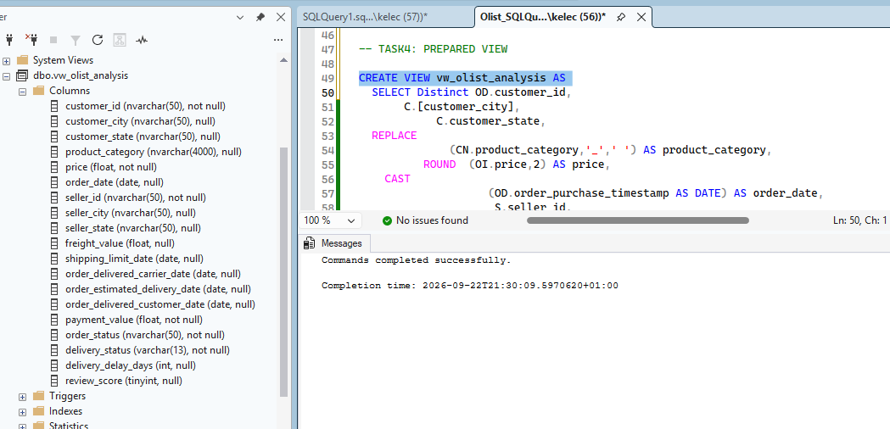

### Why I created a view

The view provided one consistent data source for the rest of the project. It avoided repeating the join and transformation logic in later queries.

### Exclusion decision

I excluded 611 records with an `unavailable` order status because they lacked key values needed for valid analysis.
```sql
WHERE OD.order_status != 'unavailable'
```
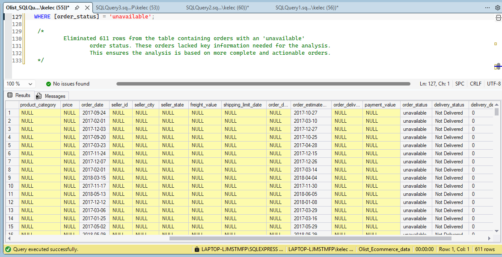

**Result:**  
The final view became the consistent source for data-quality checks, customer-retention analysis, and Power BI visualisation.


## 8. Quality and quantity checks

I ran checks for validity, completeness, and expected record counts. Each validity query was designed to return rows that violated the rule; no rows meant the issue was not found.

### Validity checks

#### Invalid delivery-date relationship

```sql
SELECT COUNT (*) AS Invalid_delivery_date_relationship
FROM Olist_Ecommerce_data.dbo.vw_olist_analysis
WHERE order_delivered_customer_date < order_date;
```
**Result:** The query returned zero rows, so the validity check passed. No customer-delivery date occurred before the corresponding purchase date.

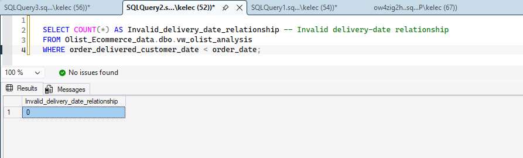

#### Delivered orders without a customer identifier

```sql
SELECT COUNT(*) AS invalid_order_to_customer_identifier
FROM Olist_Ecommerce_data.dbo.vw_olist_analysis
WHERE order_status = 'delivered'
  AND customer_unique_id IS NULL;
```
**Result:** The query returned zero rows, so the validity check passed. Every delivered order had a customer identifier.

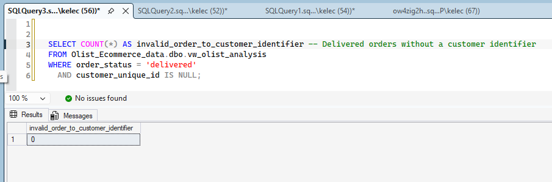

### Completeness checks

Review fields were expected to contain null values because not every order received a review. These records were retained for sales, delivery, and retention analysis but excluded from review-based metrics.

```sql
SELECT
    SUM(CASE WHEN order_id IS NULL THEN 1 ELSE 0 END) AS null_order_id,
    SUM(CASE WHEN customer_unique_id IS NULL THEN 1 ELSE 0 END) AS null_customer_unique_id,
    SUM(CASE WHEN order_status IS NULL THEN 1 ELSE 0 END) AS null_order_status,
    SUM(CASE WHEN payment_value IS NULL THEN 1 ELSE 0 END) AS null_payment_value,
    SUM(CASE WHEN review_score IS NULL THEN 1 ELSE 0 END) AS null_review_score,
    SUM(CASE WHEN product_category IS NULL THEN 1 ELSE 0 END) AS null_category,
    SUM(CASE WHEN delivery_status IS NULL THEN 1 ELSE 0 END) AS null_delivery_status
FROM Olist_Ecommerce_data.dbo.vw_olist_analysis;
```

**Result:**  
- No null values were found in `order_id`, `customer_unique_id`, `order_status`, or `delivery_status`.
- Null review values were expected and retained for investigation.
- 174 records had no payment value; one was a delivered order.
- 1,727 records had no product category.

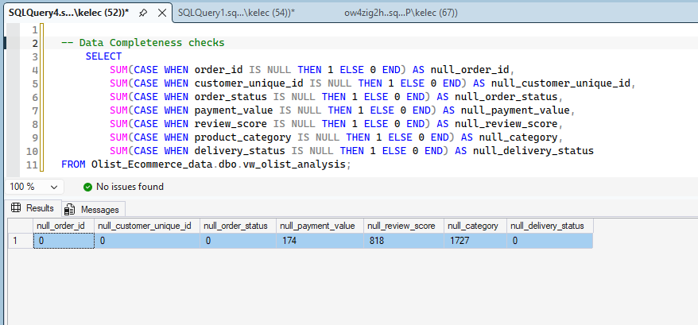

### Quantity reconciliation

```sql
SELECT
    COUNT(*) AS total_records,
    COUNT(DISTINCT customer_unique_id) AS total_unique_customers,
    COUNT(DISTINCT order_id) AS total_unique_orders
FROM Olist_Ecommerce_data.dbo.vw_olist_analysis;
```

| Check | Expected | Actual | Result |
|---|---:|---:|---|
| Total records | 106,354 | 106,354 | Matched |
| Distinct orders | 98,832 | 98,832 | Matched |
| Distinct customers | 95,526 | 95,526 | Matched |


**Note:**  
The 611 `unavailable` records were excluded in the final view, so they are not included in these counts.

## 9. Repeat-purchase analysis
I measured repeat purchasing using delivered orders and `customer_unique_id`.

### Overall repeat-purchase rate

**Definition:**  
The share of customers with at least one delivered order who made more than one delivered order within the observed period.

```sql
SELECT
    COUNT(*) AS total_repeat_customers
FROM
(
    SELECT
        customer_unique_id
    FROM Olist_Ecommerce_data.dbo.vw_olist_analysis
    WHERE order_status = 'delivered'
      AND customer_unique_id IS NOT NULL
    GROUP BY
        customer_unique_id
    HAVING
        COUNT(DISTINCT order_id) > 1
) AS RepeatCustomers;
```

**Result:**  
2,801 of 93,358 customers with at least one delivered order made more than one delivered order.


**Overall repeat-purchase rate:** 3.0%

### 12-month cohort repeat-purchase rate

**Definition:**  
The share of eligible customers who made another delivered purchase within 12 months of their first delivered order. Only customers with a full 12-month observation window were included.

**Result:**  
711 of 21,361 eligible customers made another delivered purchase within 12 months.

**12-month cohort repeat-purchase rate:** 3.33%

| Observation window | Eligible customers | Repeat customers | Cohort repeat-purchase rate |
|---|---:|---:|---:|
| Within 3 months | 21,361 | 291 | 1.36% |
| Within 6 months | 21,361 | 463 | 2.17% |
| Within 12 months | 21,361 | 711 | 3.33% |

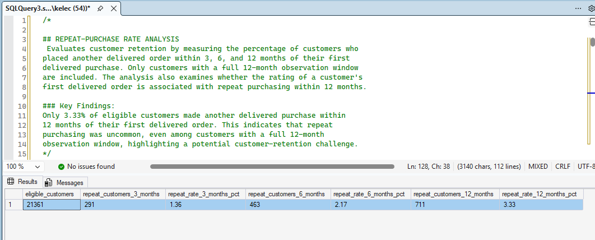

**Note:**  
These are two different measures. The overall rate includes all customers with at least one delivered order. The cohort rate includes only customers whose first delivered order occurred early enough to allow a full 12-month observation window. They do not measure churn. Because Olist is not a subscription platform, there is no cancellation event that proves a customer has left.

## 10. Review score and repeat purchasing

I examined whether the review score on a customer’s first delivered order was associated with repeat purchasing within 12 months.

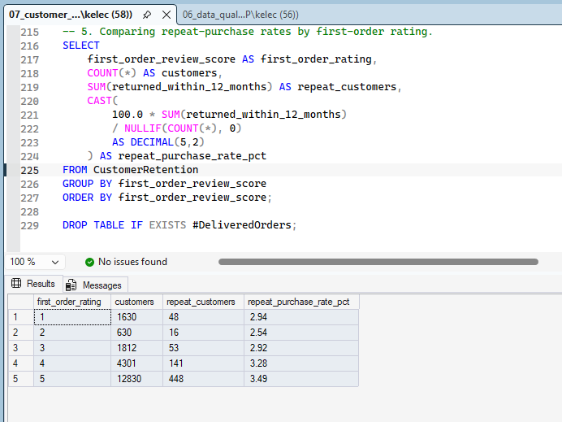

### Approach

- Created one record per delivered order.
- Identified each customer’s first delivered order.
- Included only customers with a review score and a full 12-month observation window.
- Compared repeat-purchase rates by first-order review score.

### Finding

Customers who gave higher first-order ratings showed slightly higher 12-month cohort repeat-purchase rates. The difference between the lowest and highest rating groups was 0.55 percentage points.

<p align="center">
  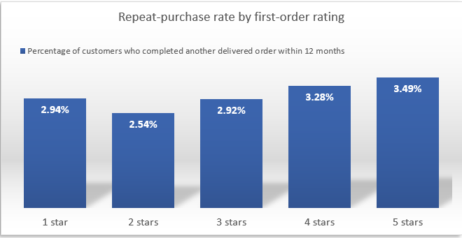
</p>
Even among five-star customers, only 3.49% made another delivered purchase within the observation window.

### Interpretation

This suggests that satisfaction alone may not be the main driver of repeat purchasing. It does not prove that satisfaction has no effect. Other factors—such as product category, order value, delivery experience, purchase frequency, and customer needs—may also influence whether customers return.


## 11. Key SQL decisions

| Decision | Reason |
|---|---|
| Used `customer_unique_id` for repeat purchases | It identifies the same customer across multiple customer records |
| Used `order_id` for order-level metrics | Prevents multi-item orders from being counted more than once |
| Calculated revenue at order grain | Prevents repeated payment values from inflating revenue |
| Used delivered orders for revenue and retention | Revenue and repeat purchasing are based on completed purchases |
| Grouped early deliveries with on-time deliveries | Both met or beat the estimated delivery date |
| Retained orders without reviews | Missing reviews were investigated rather than treated as dissatisfaction |
| Created a SQL view | Provided one consistent source for validation, analysis, and Power BI |
| Excluded unavailable orders | They lacked key values needed for valid analysis |
| Separated overall and cohort retention rates | They use different populations and observation windows |

# Technical Process: Data Visualisation with Power BI

After the SQL workflow produced a validated analytical view, I connected `vw_olist_analysis` to Power BI Desktop to build the reporting model, DAX measures, and dashboards.

The Power BI stage focused on turning the prepared data into a reporting model that could answer business questions consistently across sales, delivery, customer satisfaction, and repeat purchasing.

## Power BI workflow

```text
Connect to SQL Server
→ Load prepared analytical view
→ Review and prepare the reporting model
→ Create date table and measures table
→ Develop DAX measures
→ Design dashboard pages
→ Build visuals and filters
→ Cross-check Power BI results with SQL and DAX
→ Use Excel to examine findings
→ Review findings and limitations
```

## 1. Connect SQL Server to Power BI

I connected Power BI Desktop to the SQL Server database and loaded `vw_olist_analysis` as the main analytical table.

### Why I used the SQL view

The SQL view already contained the cleaned, transformed, and enriched data needed for analysis. Using it as the reporting source kept Power BI aligned with the SQL queries used to prepare and check the data.

### Data loaded

| Data | Purpose |
|---|---|
| `vw_olist_analysis` | Main analytical table for sales, delivery, product, seller, and customer analysis |
| Date table | Support monthly and yearly trend analysis |
| Measures table | Store reusable DAX measures |

<p align="center">
  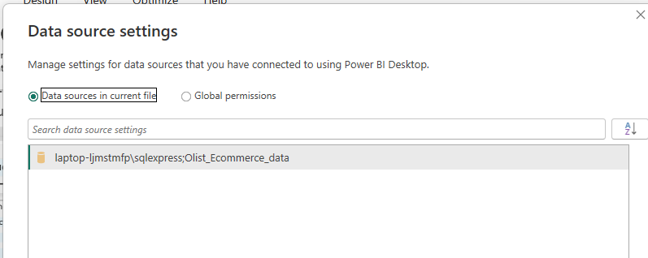
</p>

**Result:** Power BI was connected to the prepared SQL data, creating one consistent source for reporting.

## 2. Prepare the reporting model

The reporting model was built around `vw_olist_analysis`. Customer, product, seller, order, payment, review, and delivery information were already available as columns in this prepared SQL view.

### Tables in the model

| Table | Purpose |
|---|---|
| `vw_olist_analysis` | Main analytical table containing order, customer, product, seller, payment, review, and delivery information |
| Date table | Support monthly and yearly trend analysis |
| Measures table | Store reusable DAX measures |
| Customer satisfaction table | Support customer-satisfaction analysis and reporting |

### Modelling decisions

- Used `vw_olist_analysis` as the main analytical table.
- Created a date table for monthly and yearly analysis.
- Created a separate measures table to organise reusable DAX calculations.
- Created a customer-satisfaction table from the main analytical table.
- Hid technical fields that were not needed in the report view.
- Used explicit DAX measures for the main business metrics.

<p align="center">
  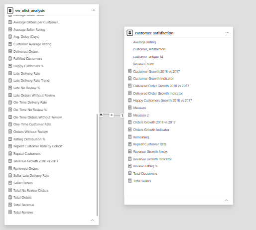
</p>

**Result:** The reporting model organised the prepared data for filtering, trend analysis, and dashboard development.

## 3. Develop DAX measures

I created reusable DAX measures so that key metrics were calculated consistently across all visuals.

### Revenue calculation issue

The analytical view contains item-level rows. One order can appear multiple times because it contains multiple items.

In this dataset, `payment_value` represents the full payment value for the order and is repeated across the item rows for that order. Therefore, revenue cannot be calculated by directly summing `payment_value` across the analytical view.

Revenue was calculated once per distinct delivered order.

### Total Revenue measure

```dax
Total Revenue = 
CALCULATE(
    SUMX(
        VALUES(vw_olist_analysis[order_id]),
        CALCULATE(MAX(vw_olist_analysis[payment_value]))
    ),
    vw_olist_analysis[order_status] = "delivered"
)
```

### How the measure works

- `VALUES(order_id)` returns each delivered order once.
- `MAX(payment_value)` returns the order’s full payment value once.
- `SUMX` sums the order-level payment values.
- The outer `CALCULATE` restricts the calculation to delivered orders.

This prevents the same order payment from being counted once for every item in the order.

### Revenue assumption

This calculation assumes that `payment_value` is the same across all rows for the same `order_id` and represents the full order payment value.

### Other key measures

| Measure | Purpose |
|---|---|
| Delivered Orders | Count distinct delivered orders |
| Distinct Customers | Count distinct customers |
| Customers with Delivered Order | Count customers with at least one delivered order |
| Overall Repeat-Purchase Rate | Measure customers with more than one delivered order |
| On-Time Delivery Rate | Measure deliveries made on or before the estimated date |
| Late Delivery Rate | Measure deliveries made after the estimated date |
| Average Review Score | Measure average customer rating |
| Positive Review Share | Measure the share of 4–5 star reviews |

<p align="center">
  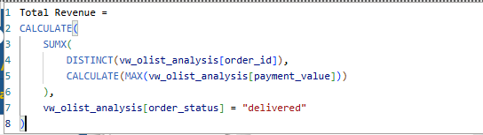
</p>

**Result:** The DAX measures provided consistent calculations for revenue, orders, customers, delivery, reviews, and repeat purchasing.

## 4. Design the analytical dashboards

I designed four report pages around business questions rather than simply displaying available fields.

| Dashboard | Business question | What it shows |
|---|---|---|
| Overview | How is the business performing overall? | Headline revenue, order, customer, delivery, review, and repeat-purchase KPIs |
| Sales Performance | How are revenue, orders, and customers changing, and where are they concentrated? | Monthly trends, state-level revenue, and customer growth |
| Delivery Performance | How reliable is delivery, and where are delays concentrated? | On-time rate, late-delivery rate, delivery delay, and state comparison |
| Customer Satisfaction & Repeat Purchasing | How satisfied are customers, and how often do they purchase again? | Review scores, positive-review share, and repeat-purchase measures |

### Dashboard design decisions

- Placed headline KPIs at the top of each page.
- Used trend charts to show performance over time.
- Used bar and column charts to compare states and categories.
- Used filters for date, state, product category, and delivery outcome.
- Used clear, business-friendly visual titles.
- Added short insight text to explain what each page reveals.

### Overview dashboard

The Overview page summarises the main business results. It highlights revenue growth, the low overall repeat-purchase rate, strong overall delivery performance, and positive customer ratings.

**Main insight:** Revenue grew strongly, but repeat purchasing remained low, highlighting an opportunity for customer re-engagement.

<p align="center">
  
</p>

### Sales Performance dashboard

The Sales Performance page compares revenue, order volume, and customer growth over time and across states. It shows that São Paulo was the largest revenue market and helps identify periods requiring further review.

**Main insight:** São Paulo contributed 37.42% of analysed revenue, while monthly revenue remained above R$950,000 in every complete month from January to August 2018.

<p align="center">
  
</p>

### Delivery Performance dashboard

The Delivery Performance page compares on-time and late delivery by state. It shows that delivery was strong overall, while identifying states such as Maranhão for further investigation.

**Main insight:** The overall on-time delivery rate was 91.9%, but Maranhão recorded a 19.7% late-delivery rate, more than twice the overall rate.

<p align="center">
  
</p>

### Customer Satisfaction & Repeat Purchasing dashboard

The Customer Satisfaction & Repeat Purchasing page examines review scores and repeat purchasing. It separates the overall repeat-purchase rate from the 12-month cohort repeat-purchase rate because they answer different questions and use different populations.

<p align="center">
  
</p>

**Result:** The dashboards allow users to move from headline KPIs to more detailed sales, delivery, and customer analysis.

## 5. Cross-check Power BI results

Before finalising the report, I cross-checked key Power BI results with SQL and DAX.

### Overall repeat-purchase rate

**Definition:**  
The share of customers with at least one delivered order who made more than one delivered order within the observed period.

**SQL and DAX result:**  
2,801 of 93,358 customers with at least one delivered order made more than one delivered order.

**Overall repeat-purchase rate:** 3.0%

### 12-month cohort repeat-purchase rate

**Definition:**  
The share of eligible customers who made another delivered purchase within 12 months of their first delivered order. Only customers with a complete 12-month observation window were included.

**SQL and DAX result:**  
711 of 21,361 eligible customers made another delivered purchase within 12 months.

**12-month cohort repeat-purchase rate:** 3.33%

### Why the two measures are different

These measures answer different questions:

| Measure | Question it answers | Population |
|---|---|---|
| Overall repeat-purchase rate | Of all customers with at least one delivered order, how many purchased again within the observed period? | 93,358 customers |
| 12-month cohort repeat-purchase rate | Of customers with enough time to return within 12 months, how many purchased again within 12 months? | 21,361 eligible customers |

They are not competing calculations of the same metric. The overall rate describes repeat purchasing across the full observed period, while the cohort rate measures repeat purchasing within a fixed 12-month window.

### Result checks

| Metric | SQL result | Power BI result | Status |
|---|---:|---:|---|
| Distinct orders | 98,832 | 98,832 | Matched |
| Delivered orders | 96,478 | 96,478 | Matched |
| Distinct customers | 95,526 | 95,526 | Matched |
| Customers with at least one delivered order | 93,358 | 93,358 | Matched |
| Total revenue | R$15.28M | R$15.28M | Matched |
| Overall repeat-purchase rate | 3.0% | 3.0% | Matched |
| São Paulo revenue share | 37.42% | 37.42% | Matched |
| Revenue growth | 22.4% | 22.4% | Matched |

<p align="center">
  
</p>

**Result:** The key Power BI results matched the SQL results, confirming that the report used consistent calculations.

## 6. Use Excel to examine findings

I used Excel to examine and explore the findings, not to validate the DAX or SQL calculations.

Excel helped me review patterns such as:

- Monthly revenue movement.
- Revenue by customer state.
- Delivery performance by state.
- Review-score distribution.
- Repeat-purchase patterns.

The final validation of key metrics was carried out using SQL queries and DAX measures. SQL provided the source-level check, while DAX confirmed that the Power BI calculations produced the expected results.

<p align="center">
  
</p>

**Result:** Excel supported the review and interpretation of findings, while SQL and DAX were used to validate the key results.

## 7. Review findings and limitations

The Power BI report supported the main findings of the analysis:

- Revenue grew 22.4% in 2018 versus 2017.
- São Paulo contributed 37.42% of analysed revenue.
- Overall delivery performance was strong, but late delivery varied by state.
- Customer ratings were positive overall.
- The overall repeat-purchase rate was 3.0%, highlighting an opportunity for customer re-engagement.
- Monthly revenue remained above R$950,000 in every complete month from January to August 2018.

### Limitations

- The report is based on historical data ending in August 2018 and does not represent current Olist performance.
- Revenue is not profit; margin, acquisition cost, and campaign cost are not available in the dataset.
- Repeat-purchase measures describe observed purchasing behaviour, not churn.
- Review scores are available only for orders that received a review.
- State-level results with small sample sizes should be interpreted carefully.
- The dashboard does not calculate customer lifetime value because customer margin, acquisition cost, and full customer-lifespan data are not available.

## Business Recommendation
| Priority | Recommendation | Suggested first action | Success measure |
|---|---|---|---|
| High | Increase repeat purchasing through customer re-engagement | Segment first-time customers and test personalised re-engagement campaigns, relevant cross-sells, and loyalty incentives | Repeat-purchase rate, repeat revenue, average order value, and customer lifetime value |

The low repeat-purchase rate suggests an opportunity to strengthen the relationship between a customer’s first purchase and their next purchase. Satisfaction and delivery performance were generally positive overall, although both should still be optimised at state level where weaknesses appear.

A structured re-engagement strategy could include:

- Relevant product recommendations based on a customer’s first purchase.
- Cross-sell and upsell suggestions for complementary products.
- A loyalty or rewards programme with clear early milestones.
- Post-purchase follow-up communication and reorder reminders.
- Targeted win-back offers for customers who have not returned within a defined period.
- Controlled testing to measure incremental repeat purchases and return on campaign spend.

These actions should be tested rather than assumed to work. Their impact should be measured against a control group using repeat-purchase rate, average order value, repeat revenue, and customer lifetime value.
