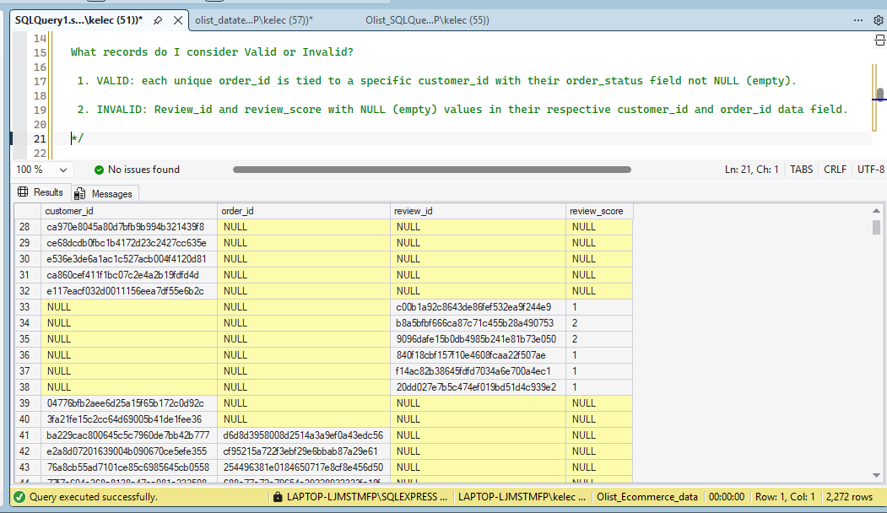
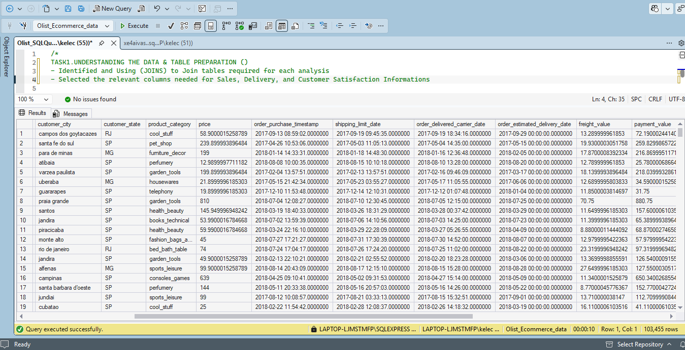
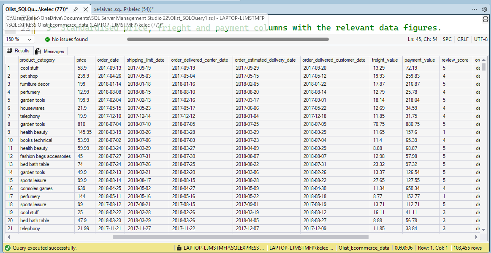
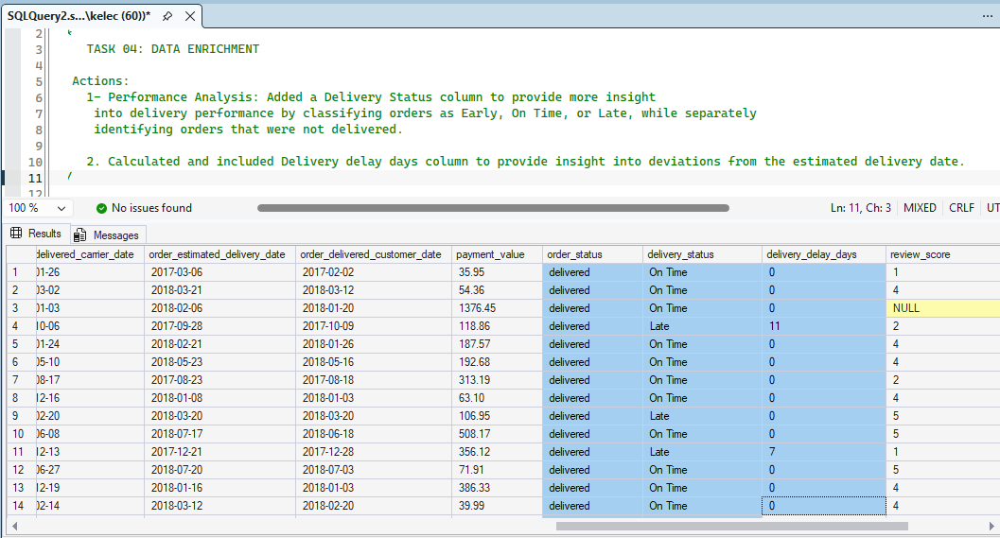
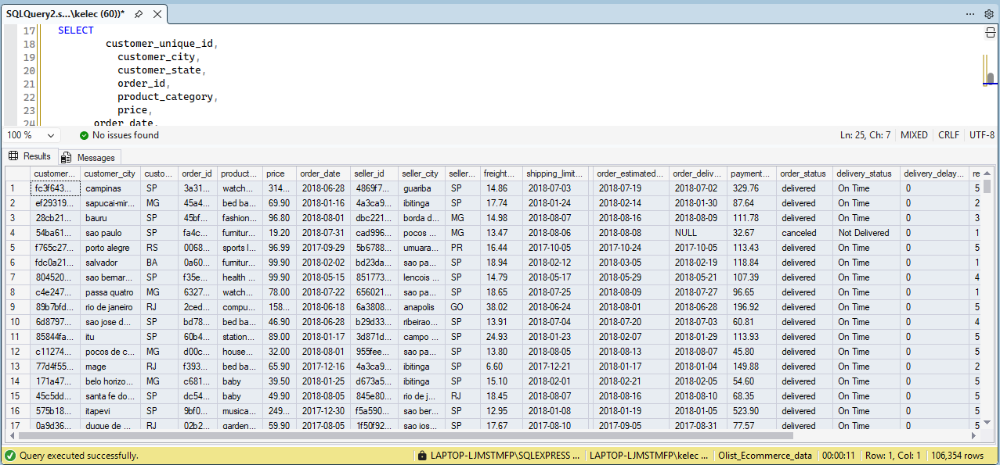
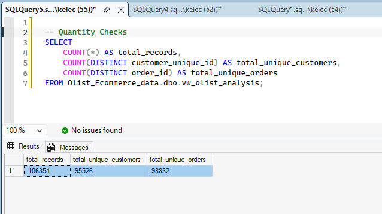
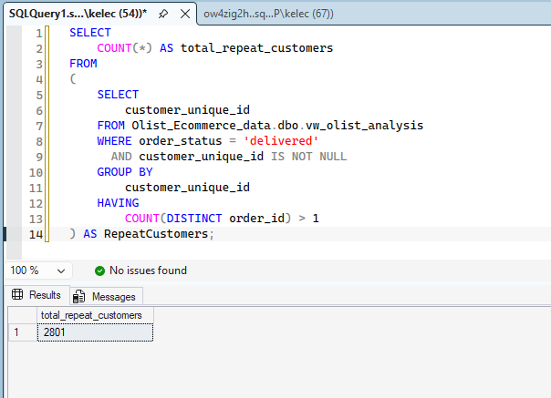

# Technical Process

This document explains how I prepared, validated, and analysed the Olist e-commerce dataset using SQL Server.

The workflow moved from raw CSV files to a validated analytical view, then to Power BI dashboards and business findings.

## Workflow

```text
Data collection and import
→ Explore and understand the data
→ Define the information required
→ Join source tables
→ Clean and transform the data
→ Add delivery-performance fields
→ Prepare the final analytical view
→ Run quality and quantity checks
→ Analyse customer retention
→ Build Power BI dashboards
→ Validate results in Excel
```

## 1. Data collection and import

I downloaded the Olist dataset from Kaggle in CSV format and imported the files into SQL Server using SQL Server Management Studio (SSMS).

I reviewed each file to understand its contents and how the tables related to one another.

### Source tables

| Table | What it provides |
|---|---|
| `orders_dataset` | Order status, purchase date, and delivery dates |
| `customers_dataset` | Customer location and unique customer identifier |
| `order_items_dataset` | Items, sellers, price, and freight value |
| `order_payments_dataset` | Payment value |
| `order_reviews_dataset` | Review score and review identifier |
| `products_dataset` | Product category |
| `sellers_dataset` | Seller location |
| `product_category_translation` | English product-category names |


## 2. Explore and understand the data

Before joining the tables, I checked how orders, customers, items, payments, and reviews were connected.

### Key data-grain issue

A single `order_id` can contain multiple items. It can also have multiple payment records and, in some cases, multiple review records.

This means a joined table can contain repeated order, payment, and review values at item level. A direct sum of `payment_value` across the joined table could therefore overstate revenue.

For this reason, revenue and other order-level measures were calculated once per distinct delivered `order_id`.

### Review handling

Some orders had no review score. I retained these records because a missing review does not prove dissatisfaction.

For review analysis, I included only orders with a review score. For sales, delivery, and retention analysis, an order without a review could still be included.

### Initial missing-record check

I ran an initial check for missing or unlinked order and review information.

```sql
SELECT DISTINCT
    OD.customer_id,
    O.order_id,
    R.review_id,
    R.review_score
FROM dbo.order_items_dataset AS O
FULL JOIN dbo.order_reviews_dataset AS R
    ON O.order_id = R.order_id
FULL JOIN dbo.orders_dataset AS OD
    ON O.order_id = OD.order_id
WHERE OD.customer_id IS NULL
   OR O.order_id IS NULL
   OR R.review_id IS NULL;
```



**Result:**  
This query identified records with incomplete order, customer, or review relationships. It does not isolate only orphaned review records: orders without a review are also returned because the review fields are null after the join.

Orders without reviews were retained for sales, delivery, and retention analysis. They were excluded only from review-based metrics.

## 3. Define the information required

I identified the information needed for the three main areas of analysis.

| Analysis area | Information required |
|---|---|
| Sales | Order date, order status, customer state, product category, price, payment value, seller state |
| Delivery | Purchase date, shipping limit, carrier delivery date, estimated delivery date, customer delivery date |
| Customer satisfaction and retention | Review score, customer unique identifier, order identifier, order date, delivery outcome |

### Key analytical decisions

- I used `customer_unique_id` for customer-level repeat-purchase analysis.
- I used `order_id` to prevent orders from being counted more than once.
- I treated delivered orders as completed purchases for revenue and repeat-purchase analysis.
- I focused on calendar dates rather than timestamps.

## 4. Join the source tables

I joined the source tables needed for sales, delivery, and customer-satisfaction analysis.

The source tables have different levels of detail:

- `orders_dataset` has one row per order.
- `order_items_dataset` can have multiple rows per order.
- `order_payments_dataset` can have multiple rows per order.
- `order_reviews_dataset` can have multiple review records per order.

Joining these tables can create repeated order, payment, and review values at item level. `SELECT DISTINCT` removes fully identical rows, but it does not solve every duplication issue caused by different table grains.

For that reason, the joined query was used to prepare the analytical dataset—not to calculate revenue. Revenue was calculated separately at order grain.

### Join design

| Table | Join key | Information added |
|---|---|---|
| `orders_dataset` | `order_id` | Order status and delivery dates |
| `order_reviews_dataset` | `order_id` | Review score and review identifier |
| `order_items_dataset` | `order_id` | Product, seller, price, and freight value |
| `products_dataset` | `product_id` | Product category |
| `order_payments_dataset` | `order_id` | Payment value |
| `customers_dataset` | `customer_id` | Customer location and unique customer identifier |
| `sellers_dataset` | `seller_id` | Seller location |
| `product_category_translation` | `product_category_name` | English category name |

```sql
USE Olist_Ecommerce_data;

SELECT DISTINCT
    OD.order_id,
    C.customer_id,
    C.customer_city,
    C.customer_state,
    CN.product_category,
    OI.price,
    OD.order_purchase_timestamp,
    OI.shipping_limit_date,
    OD.order_delivered_carrier_date,
    OD.order_estimated_delivery_date,
    OI.freight_value,
    OP.payment_value,
    OD.order_delivered_customer_date,
    O.review_score,
    OD.order_status,
    S.seller_id,
    S.seller_city,
    S.seller_state
FROM dbo.orders_dataset AS OD
LEFT JOIN dbo.order_reviews_dataset AS O
    ON OD.order_id = O.order_id
LEFT JOIN dbo.order_items_dataset AS OI
    ON OD.order_id = OI.order_id
LEFT JOIN dbo.products_dataset AS P
    ON OI.product_id = P.product_id
LEFT JOIN dbo.order_payments_dataset AS OP
    ON OI.order_id = OP.order_id
LEFT JOIN dbo.customers_dataset AS C
    ON OD.customer_id = C.customer_id
LEFT JOIN dbo.sellers_dataset AS S
    ON OI.seller_id = S.seller_id
LEFT JOIN dbo.product_category_translation AS CN
    ON P.product_category_name = CN.product_category_name;
```



**Note:**  
Use the actual column names from your imported translation table. If your imported table uses `Portugues`, replace `CN.product_category_name` with `CN.Portugues` and add a note explaining the imported column name.

## 5. Clean and transform the data

I standardised the fields needed for consistent reporting.

### Actions taken

- Removed underscores from product-category names.
- Converted relevant datetime fields to dates.
- Rounded price, freight value, and payment value to two decimal places.
- Prepared date fields for monthly and yearly analysis.

```sql
REPLACE(CN.product_category, '_', ' ') AS product_category,
CAST(OD.order_purchase_timestamp AS DATE) AS order_date,
CAST(OI.shipping_limit_date AS DATE) AS shipping_limit_date,
CAST(OD.order_delivered_carrier_date AS DATE) AS order_delivered_carrier_date,
CAST(OD.order_estimated_delivery_date AS DATE) AS order_estimated_delivery_date,
CAST(OD.order_delivered_customer_date AS DATE) AS order_delivered_customer_date,
ROUND(OI.price, 2) AS price,
ROUND(OI.freight_value, 2) AS freight_value,
ROUND(OP.payment_value, 2) AS payment_value
```



**Result:**  
The category, date, and financial fields were standardised for analysis.

## 6. Add delivery-performance fields

I created `delivery_status` and `delivery_delay_days` to support delivery analysis.

### Delivery-status definition

| Status | Definition |
|---|---|
| On time | Delivered on or before the estimated delivery date |
| Late | Delivered after the estimated delivery date |
| Not delivered | No customer-delivery date was recorded |

Early deliveries were grouped with on-time deliveries because both met or beat the estimated delivery date.

### Delivery-delay definition

`delivery_delay_days` measures how many days late an order was.

- On-time deliveries, including early deliveries, were assigned zero days.
- Late deliveries were assigned the number of days after the estimated delivery date.
- The field does not show negative values for early deliveries.
- Orders without a customer-delivery date were not assessed for lateness.

```sql
CASE
    WHEN OD.order_status IN ('canceled', 'processing', 'unavailable')
        THEN 'Not Delivered'
    WHEN OD.order_delivered_customer_date IS NULL
        THEN 'Not Delivered'
    WHEN OD.order_delivered_customer_date <= OD.order_estimated_delivery_date
        THEN 'On Time'
    ELSE 'Late'
END AS delivery_status,

CASE
    WHEN OD.order_delivered_customer_date > OD.order_estimated_delivery_date
        THEN DATEDIFF(
            DAY,
            OD.order_estimated_delivery_date,
            OD.order_delivered_customer_date
        )
    WHEN OD.order_delivered_customer_date IS NULL
        THEN NULL
    ELSE 0
END AS delivery_delay_days
```



**Result:**  
The fields separated confirmed deliveries from orders without a recorded customer-delivery date and measured lateness for late deliveries.

## 7. Prepare the final analytical view

I created `vw_olist_analysis`, a SQL view containing the prepared data for quality checks, Power BI, and analysis.

### Why I created a view

The view provided one consistent data source for the rest of the project. It avoided repeating the join and transformation logic in later queries.

### Exclusion decision

I excluded 611 records with an `unavailable` order status because they lacked key values needed for valid analysis.

```sql
WHERE OD.order_status != 'unavailable'
```



**Result:**  
The final view became the consistent source for data-quality checks, customer-retention analysis, and Power BI visualisation.

## 8. Quality and quantity checks

I ran checks for validity, completeness, and expected record counts. Each validity query was designed to return rows that violated the rule; no rows meant the issue was not found.

### Validity checks

#### Invalid delivery-date relationship

```sql
SELECT COUNT (*) AS Invalid_delivery_date_relationship
FROM Olist_Ecommerce_data.dbo.vw_olist_analysis
WHERE order_delivered_customer_date < order_date;
```

**Result:** No rows returned. No customer-delivery date occurred before the purchase date.

#### Delivered orders without a customer identifier

```sql
SELECT COUNT(*) AS invalid_order_to_customer_identifier
FROM Olist_Ecommerce_data.dbo.vw_olist_analysis
WHERE order_status = 'delivered'
  AND customer_unique_id IS NULL;
```

**Result:** No rows returned. Every delivered order had a customer identifier.

### Completeness checks

Review fields were expected to contain null values because not every order received a review. These records were retained for sales, delivery, and retention analysis but excluded from review-based metrics.

```sql
SELECT
    SUM(CASE WHEN order_id IS NULL THEN 1 ELSE 0 END) AS null_order_id,
    SUM(CASE WHEN customer_unique_id IS NULL THEN 1 ELSE 0 END) AS null_customer_unique_id,
    SUM(CASE WHEN order_status IS NULL THEN 1 ELSE 0 END) AS null_order_status,
    SUM(CASE WHEN payment_value IS NULL THEN 1 ELSE 0 END) AS null_payment_value,
    SUM(CASE WHEN review_score IS NULL THEN 1 ELSE 0 END) AS null_review_score,
    SUM(CASE WHEN product_category IS NULL THEN 1 ELSE 0 END) AS null_category,
    SUM(CASE WHEN delivery_status IS NULL THEN 1 ELSE 0 END) AS null_delivery_status
FROM Olist_Ecommerce_data.dbo.vw_olist_analysis;
```

**Result:**  
- No null values were found in `order_id`, `customer_unique_id`, `order_status`, or `delivery_status`.
- Null review values were expected and retained for investigation.
- 174 records had no payment value; one was a delivered order.
- 1,727 records had no product category.

### Quantity reconciliation

```sql
SELECT
    COUNT(*) AS total_records,
    COUNT(DISTINCT customer_unique_id) AS total_unique_customers,
    COUNT(DISTINCT order_id) AS total_unique_orders
FROM Olist_Ecommerce_data.dbo.vw_olist_analysis;
```

| Check | Expected | Actual | Result |
|---|---:|---:|---|
| Total records | 106,354 | 106,354 | Matched |
| Distinct orders | 98,832 | 98,832 | Matched |
| Distinct customers | 95,526 | 95,526 | Matched |



**Note:**  
The 611 `unavailable` records were excluded in the final view, so they are not included in these counts. A matching count confirms that the final view returned the expected volume; it does not by itself prove that every underlying source value is correct.

## 9. Repeat-purchase analysis
I measured repeat purchasing using delivered orders and `customer_unique_id`.

### Overall repeat-purchase rate

**Definition:**  
The share of customers with at least one delivered order who made more than one delivered order within the observed period.

```sql
SELECT
    COUNT(*) AS total_repeat_customers
FROM
(
    SELECT
        customer_unique_id
    FROM Olist_Ecommerce_data.dbo.vw_olist_analysis
    WHERE order_status = 'delivered'
      AND customer_unique_id IS NOT NULL
    GROUP BY
        customer_unique_id
    HAVING
        COUNT(DISTINCT order_id) > 1
) AS RepeatCustomers;
```

**Result:**  
2,801 of 93,358 customers with at least one delivered order made more than one delivered order.

**Overall repeat-purchase rate:** 3.0%

### 12-month cohort repeat-purchase rate

**Definition:**  
The share of eligible customers who made another delivered purchase within 12 months of their first delivered order. Only customers with a full 12-month observation window were included.

**Result:**  
711 of 21,361 eligible customers made another delivered purchase within 12 months.

**12-month cohort repeat-purchase rate:** 3.33%

| Observation window | Eligible customers | Repeat customers | Cohort repeat-purchase rate |
|---|---:|---:|---:|
| Within 3 months | 21,361 | 291 | 1.36% |
| Within 6 months | 21,361 | 463 | 2.17% |
| Within 12 months | 21,361 | 711 | 3.33% |



**Note:**  
These are two different measures. The overall rate includes all customers with at least one delivered order. The cohort rate includes only customers whose first delivered order occurred early enough to allow a full 12-month observation window. They do not measure churn. Because Olist is not a subscription platform, there is no cancellation event that proves a customer has left.

## 10. Review score and repeat purchasing

I examined whether the review score on a customer’s first delivered order was associated with repeat purchasing within 12 months.

### Approach

- Created one record per delivered order.
- Identified each customer’s first delivered order.
- Included only customers with a review score and a full 12-month observation window.
- Compared repeat-purchase rates by first-order review score.

### Finding

Customers who gave higher first-order ratings showed slightly higher 12-month cohort repeat-purchase rates. The difference between the lowest and highest rating groups was 0.55 percentage points.

Even among five-star customers, only 3.49% made another delivered purchase within the observation window.

### Interpretation

This suggests that satisfaction alone may not be the main driver of repeat purchasing. It does not prove that satisfaction has no effect. Other factors—such as product category, order value, delivery experience, purchase frequency, and customer needs—may also influence whether customers return.


## 11. Key SQL decisions

| Decision | Reason |
|---|---|
| Used `customer_unique_id` for repeat purchases | It identifies the same customer across multiple customer records |
| Used `order_id` for order-level metrics | Prevents multi-item orders from being counted more than once |
| Calculated revenue at order grain | Prevents repeated payment values from inflating revenue |
| Used delivered orders for revenue and retention | Revenue and repeat purchasing are based on completed purchases |
| Grouped early deliveries with on-time deliveries | Both met or beat the estimated delivery date |
| Retained orders without reviews | Missing reviews were investigated rather than treated as dissatisfaction |
| Created a SQL view | Provided one consistent source for validation, analysis, and Power BI |
| Excluded unavailable orders | They lacked key values needed for valid analysis |
| Separated overall and cohort retention rates | They use different populations and observation windows |

## Business Recommendation
| Priority | Recommendation | Suggested first action | Success measure |
|---|---|---|---|
| High | Increase repeat purchasing through customer re-engagement | Segment first-time customers and test personalised re-engagement campaigns, relevant cross-sells, and loyalty incentives | Repeat-purchase rate, repeat revenue, average order value, and customer lifetime value |

The low repeat-purchase rate suggests an opportunity to strengthen the relationship between a customer’s first purchase and their next purchase. Satisfaction and delivery performance were generally positive overall, although both should still be optimised at state level where weaknesses appear.

A structured re-engagement strategy could include:

- Relevant product recommendations based on a customer’s first purchase.
- Cross-sell and upsell suggestions for complementary products.
- A loyalty or rewards programme with clear early milestones.
- Post-purchase follow-up communication and reorder reminders.
- Targeted win-back offers for customers who have not returned within a defined period.
- Controlled testing to measure incremental repeat purchases and return on campaign spend.

These actions should be tested rather than assumed to work. Their impact should be measured against a control group using repeat-purchase rate, average order value, repeat revenue, and customer lifetime value.
