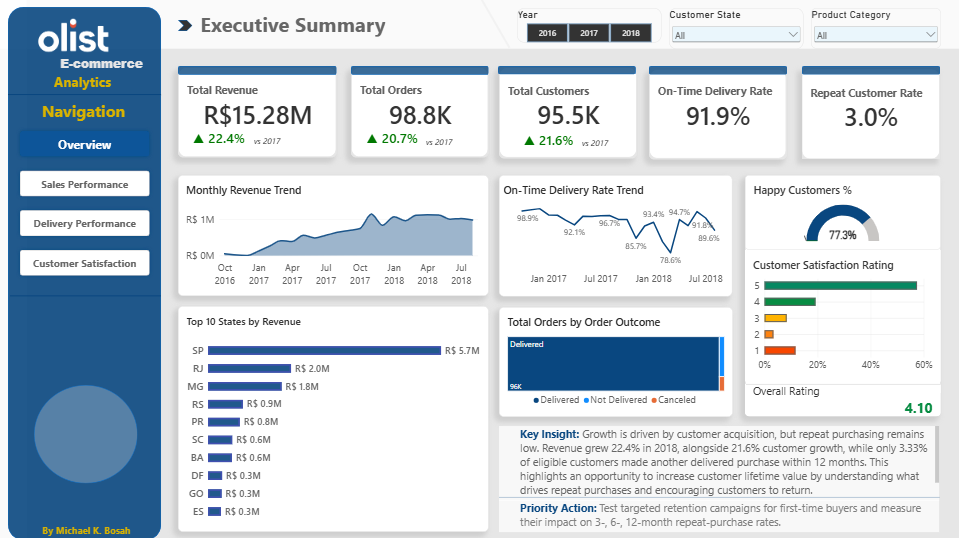
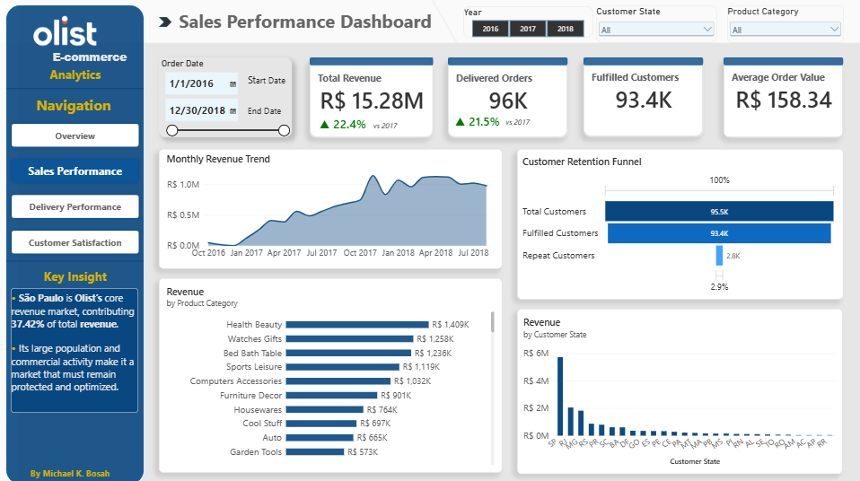
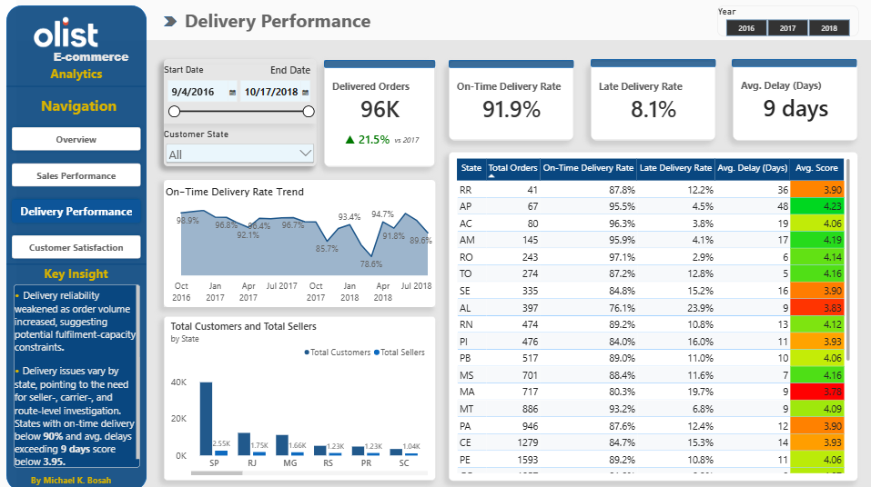
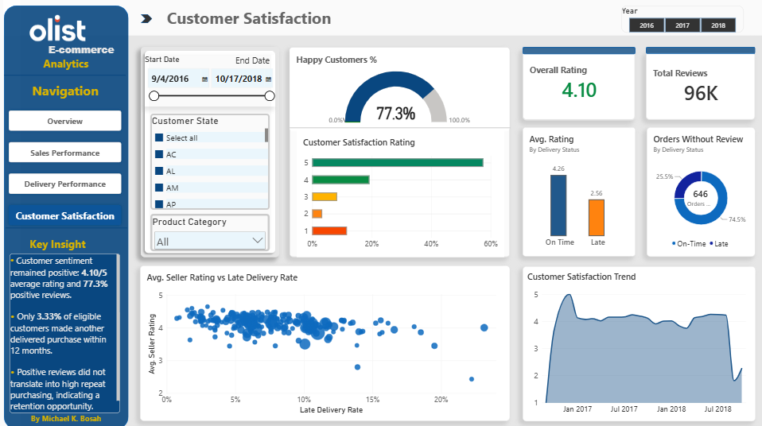

# Olist E-Commerce Analytics
### Sales Performance, Delivery Reliability & Customer Retention
An end-to-end data analytics project exploring sales performance, delivery operations, customer satisfaction, and repeat purchasing in the Olist Brazilian e-commerce marketplace.

**Key result:** Revenue grew 22.4% in 2018, but only 3.0% of customers with at least one delivered order made another delivered purchase within the observed period, highlighting an opportunity to strengthen customer re-engagement and increase customer lifetime value.
**Technical walkthrough:** See [`Documentation/technical_process.md`](Documentation/technical_process.md) for the full step-by-step process, SQL validation evidence, data-modelling decisions, and dashboard development notes.

**Tools:** SQL Server · Power BI · DAX · Excel  
**Project focus:** Business and Operations Analytics  
**Dataset:** [Brazilian E-Commerce Public Dataset by Olist](https://www.kaggle.com/datasets/olistbr/brazilian-ecommerce)

---

## Executive Summary

**Business question:**  
Is Olist’s revenue growth being supported by repeat purchasing and reliable delivery?

**Headline finding:**  
Revenue grew 22.4% in 2018 versus 2017, supported by 21.6% customer growth. However, only 3.0% of the 93,358 customers with at least one delivered order made another delivered purchase.

Delivery performance was strong overall, with 91.9% of orders delivered on time, but late delivery varied materially by state. Maranhão recorded a 19.7% late-delivery rate, more than double the overall 8.1% rate.

**Recommendation:**  
Test targeted retention campaigns for customers with at least one delivered order and investigate regional delivery bottlenecks, beginning with Maranhão.



---

## 1. Business Problem

Olist connects sellers with customers through an online marketplace. Revenue growth and customer acquisition are important, but they do not show whether customers return to purchase again or whether delivery operations remain reliable.

This project examines sales trends, delivery performance, customer reviews, and repeat purchases to identify where the business performs well and where further investigation may be valuable.

### Key business questions

- How are revenue, order volume, and customer numbers changing over time?
- Which states contribute most to revenue, orders, and seller activity?
- How reliably are orders delivered, and where are delays most common?
- What do customer reviews reveal about the shopping experience?
- What proportion of customers with at least one delivered order make another delivered purchase?
- Which areas should the business prioritise for further investigation?

---

## 2. Project at a Glance

| Metric | Result |
|---|---:|
| Distinct orders | 98,832 |
| Delivered orders | 96,478 |
| Distinct customers | 95,526 |
| Customers with at least one delivered order | 93,358 |
| Revenue | R$15.28M |
| On-time delivery rate | 91.9% |
| Late delivery rate | 8.1% |
| Average review score | 4.10/5 |
| Positive review share (4–5 stars) | 77.3% |
| Overall repeat-purchase rate | 3.0% |

*The overall repeat-purchase rate is calculated among the 93,358 customers with at least one delivered order. Only delivered orders are treated as qualifying purchases. The 12-month cohort rate uses a different eligible population and observation window.*

---

## 3. Key Findings

### Finding 1: Strong Customer acquisition is not yielding as many repeat purchases over time

Revenue grew by 22.4%, and the customer base grew by 21.6% in 2018 versus 2017. Because the dataset ends in October 2018, year-over-year comparisons use matching date ranges.

Among the 93,358 customers with at least one delivered order, 3.0% made at least one additional delivered purchase. In the separate 12-month cohort analysis, 711 of 21,361 eligible customers—3.33%—made a subsequent delivered purchase within 12 months.

| Observation window | Eligible customers | Repeat customers | Repeat-purchase rate |
|---|---:|---:|---:|
| Within 3 months | 21,361 | 291 | 1.36% |
| Within 6 months | 21,361 | 463 | 2.17% |
| Within 12 months | 21,361 | 711 | 3.33% |

**Business implication:** Acquisition-led growth may not be translating into frequent repeat purchasing. Olist could investigate how to encourage customers with completed purchases to return through relevant product recommendations, post-purchase engagement, and structured re-engagement campaigns.

Because Olist is not a subscription platform, customers who did not purchase again cannot be classified as churned. They may not have needed another product, may purchase infrequently, or may have been acquired too recently to observe another purchase. The low repeat-purchase rate therefore identifies a re-engagement opportunity rather than proving customer loss.

**Recommended next step:** Segment first-time customers by product category, order value, delivery outcome, and review score. Test targeted re-engagement campaigns against a control group and measure incremental repeat purchases, average order value, and customer lifetime value.

### Finding 2: São Paulo is Olist’s core revenue market

São Paulo (SP) contributed 37.42% of the R$15.28 million in analysed revenue, approximately R$5.72 million.

The state also recorded:

- 40,501 delivered orders.
- Approximately 40,029 unique customers.
- 1,848 sellers out of 3,093 across the 27 states in the analysis.
- An average review score of 4.22/5.
- A late-delivery rate of 5.9%.
- A repeat-purchase rate of approximately 3.2%.

São Paulo’s large population, commercial activity, and customer base provide context for its market size. It is Olist’s core revenue market and should remain a priority for performance monitoring and customer-retention efforts.

**Business implication:** Strong sales and relatively reliable delivery do not automatically translate into frequent repeat purchases. Olist could investigate product selection, pricing, customer needs, and the experience between purchases.

### Finding 3: Delivery performance differs by state

The overall on-time delivery rate was 91.9%, while 8.1% of orders were delivered late. State-level results reveal differences that the national average can conceal.

| State | Delivered orders | Average rating | Late-delivery rate | Repeat-purchase rate |
|---|---:|---:|---:|---:|
| São Paulo (SP) | 40,501 | 4.22 | 5.9% | Approximately 3.2% |
| Acre (AC) | 80 | 4.06 | Not reported here | 5.2% |
| Maranhão (MA) | 717 | 3.78 | 19.7% | Not reported here |
| Overall | 96,478 | 4.10 | 8.1% | 3.0% |

Maranhão’s late-delivery rate was more than twice the overall rate, alongside an average rating of 3.78/5. This makes the state a priority for further delivery investigation.

Acre recorded a 5.2% repeat-purchase rate, but its 80 delivered orders provide a limited basis for comparison. São Paulo combined relatively strong delivery performance and customer ratings with a repeat-purchase rate of approximately 3.2%.

**Business implication:** Investigate delivery issues by seller, carrier, destination, and dispatch timing in regions with elevated late-delivery rates. Analyse retention separately rather than assuming delivery performance alone explains whether customers return.

### Finding 4: Seller activity is geographically concentrated

São Paulo accounted for 1,848 of the 3,093 sellers included in the state analysis — approximately 59.7% — and contributed 37.42% of analysed revenue.

This concentration coincided with the state’s leading sales contribution. However, the analysis does not establish that seller concentration caused the revenue advantage; customer demand, population, product availability, and other factors may also contribute.

**Business implication:** Examine seller coverage and product availability across states to identify potential gaps and understand how geographic concentration relates to marketplace performance.

### Finding 5: Revenue declined after May 2018

Monthly delivered-order revenue was R$1,119,878 in May 2018, R$1,018,894 in July 2018, and R$977,115 around October 2018.

This indicates a downward revenue trend over the latter part of the observed period. The decline should be investigated by separating changes in order volume, average order value, product-category mix, and seasonality.

**Business implication:** Before recommending corrective action, determine whether the decline was driven by fewer orders, lower average order value, changes in product mix, or seasonal demand.

---

## 4. Power BI Dashboard

The report contains four pages: an executive overview followed by three detailed analysis pages.

### Overview Dashboard


Provides an executive-level summary of the analysis across sales, delivery performance, customer satisfaction, and repeat purchasing.

**Purpose:**
- Present headline KPIs in one view.
- Summarise the main findings from the analysis.
- Provide a starting point for exploring the detailed dashboards.

**Key metrics displayed:**
- Revenue
- Delivered orders
- Customers with at least one delivered order
- Revenue growth
- On-time and late-delivery rates
- Average review score
- Overall repeat-purchase rate

### Sales Performance



Examines revenue, order volume, customer numbers, monthly trends, and state-level sales contributions.

**Questions explored:**
- How are revenue and customer numbers changing?
- Which states contribute most to sales?
- Which periods require further investigation?

### Delivery Performance



Evaluates on-time delivery, late deliveries, and differences in delivery performance across states.

**Questions explored:**
- What proportion of delivered orders arrived on time?
- Which states have elevated late-delivery rates?
- Where should logistics performance be investigated?

### Customer Satisfaction & Repeat Purchasing



Explores review scores, positive review share, and repeat purchasing.

**Questions explored:**
- How do customers rate their shopping experience?
- What share of reviews is positive?
- What proportion of customers with at least one delivered order make another delivered purchase?
- Do customer ratings and repeat purchasing show the same pattern?
---

## 5. Technical Approach

The project followed an end-to-end workflow: data exploration, table joins, cleaning and transformation, enrichment, final-table preparation, data-quality validation, Power BI modelling, DAX development, dashboard design, and SQL-to-Power BI reconciliation.

For the full technical walkthrough, including SQL query examples, validation evidence, data-model decisions, and dashboard development notes, see [`Documentation/technical_process.md`](Documentation/technical_process.md).

### Data collection and understanding

Imported the Olist CSV tables into SQL Server and explored row counts, identifiers, missing values, data types, and relationships between orders, customers, items, products, sellers, payments, and reviews.

### Data preparation and validation

Used SQL to join source tables, clean and transform fields, translate product categories, enrich the analytical dataset, prepare the final analytical table, and validate record counts and distinct identifiers.

The joins required particular care because the source tables represent different levels of detail. An order may contain multiple items and payment records, so a joined row count cannot be treated as a distinct order count.

### SQL analysis

Analysed sales trends, state-level performance, delivery outcomes, review scores, and repeat purchasing. The retention analysis used `customer_unique_id` and qualifying delivered orders to measure subsequent purchases within 3-, 6-, and 12-month observation windows.

### Power BI and DAX

Built interactive dashboards using KPIs, trend charts, state comparisons, and filters. Revenue was calculated once per distinct delivered `order_id`, preventing payment values repeated across item-level rows from being summed multiple times.

### Interpretation and recommendations

Compared findings across sales, delivery, and customer analysis. External research provided context for regional differences, while recommendations were framed as areas for investigation or testing rather than claims of proven causation.

---

## 6. Recommendations

| Priority | Recommendation | Suggested first action | Success measure |
|---|---|---|---|
| High | Improve repeat purchasing | Segment customers with one delivered order and test targeted re-engagement campaigns | Overall repeat-purchase rate; 3-, 6-, and 12-month cohort rates |
| High | Investigate late delivery in Maranhão | Review late orders by seller, carrier, destination, and dispatch timing | Late-delivery rate and average delay |
| Medium | Understand geographic performance | Compare seller coverage, product availability, and demand across states | Revenue and order share by state |
| Medium | Investigate the post-May revenue decline | Separate changes in order volume, AOV, and product mix | Monthly revenue, orders, and AOV |
| Medium | Assess retention economics | Add margin, acquisition cost, and campaign cost data where available | Incremental repeat revenue and campaign ROI |

These are proposed next steps based on observed patterns; their impact would need to be tested using additional data or controlled experiments.

---

## 7. Limitations

- **Historical coverage:** The dataset ends in October 2018 and does not describe Olist’s current performance.
- **Partial final year:** Year-over-year comparisons use matching date ranges.
- **Observational analysis:** Relationships between delivery, review scores, sales, and repeat purchasing do not establish causation.
- **Small regional samples:** Acre’s 80 delivered orders limit the reliability of its repeat-purchase rate as a benchmark.
- **Different data grains:** Joined rows may represent item-level combinations rather than unique orders, payments, or reviews. Aggregations must account for these relationships.
- **Revenue calculation:** Payment values in the joined analytical view can repeat across item rows. Revenue is calculated once per distinct delivered `order_id`, not by directly summing repeated values.
- **Review coverage:** Review scores reflect submitted reviews and may not represent all customers.
- **Retention definitions:** The overall repeat-purchase rate and 12-month cohort rate use different populations and rules and should not be treated as interchangeable.
- **Date precision:** The prepared order date is stored as a date, not a timestamp. Same-day purchases cannot reliably be sequenced using that field alone.
- **Financial scope:** Revenue is not profit. Profitability, customer lifetime value, and campaign return cannot be established without additional cost and margin data.

---

## 8. Repository Structure

```text
olist-ecommerce-analytics/
│
├── Documentation/
│   ├── business_questions.md
│   ├── data_dictionary.md
│   └── dax_measures.md
│
├── Images/
│   ├── 01_overview_dashboard.png
│   ├── 02_sales_performance_dashboard.png
│   ├── 03_delivery_performance_dashboard.png
│   └── 04_customer_satisfaction_dashboard.png
│
├── PowerBI_Dashboards/
│   └── olist_ecommerce_analytics.pbix
│
├── SQL_Scripts/
│   ├── 01_data_exploration.sql
│   ├── 02_table_joins.sql
│   ├── 03_data_cleaning_and_transformation.sql
│   ├── 04_data_enrichment.sql
│   ├── 05_final_table_preparation.sql
│   ├── 06_data_quality_checks.sql
│   └── 07_customer_retention.sql
│
└── README.md
```
The `Documentation/` folder contains the project’s business questions, data dictionary, and DAX measure documentation. The `SQL_Scripts/` folder contains the full SQL workflow, while `PowerBI_Dashboards/` contains the interactive Power BI report, including an executive overview dashboard and three detailed analysis dashboards.

---

## 9. Dataset and Acknowledgements

**Dataset:** [Brazilian E-Commerce Public Dataset by Olist — Kaggle](https://www.kaggle.com/datasets/olistbr/brazilian-ecommerce)

The dataset contains anonymised historical e-commerce records covering orders, customers, sellers, products, payments, reviews, and logistics. External research was used to provide context for regional population and urbanisation differences, not to establish the causes of the observed sales patterns.

---

## 10. What This Project Demonstrates

This project demonstrates the use of SQL Server and Power BI to prepare data, validate key counts, analyse business performance, build dashboards, and translate findings into practical recommendations.

The focus is not only on reporting metrics, but also on understanding what they reveal, recognising where joins can distort results, and distinguishing observed patterns from conclusions that require further evidence.

---

## 11. How to Reproduce

1. Download the dataset from [Kaggle](https://www.kaggle.com/datasets/olistbr/brazilian-ecommerce).
2. Import the required CSV files into SQL Server.
3. Run the SQL scripts in `SQL_Scripts/` in the following order:

```text
01_data_exploration.sql
02_table_joins.sql
03_data_cleaning_and_transformation.sql
04_data_enrichment.sql
05_final_table_preparation.sql
06_data_quality_checks.sql
07_customer_retention.sql
```

4. Open the Power BI report in `PowerBI_Dashboards/olist_ecommerce_analytics.pbix`.
5. Update the data-source settings as required and refresh the model.
6. Review the dashboard pages and compare the results with the figures reported here.
